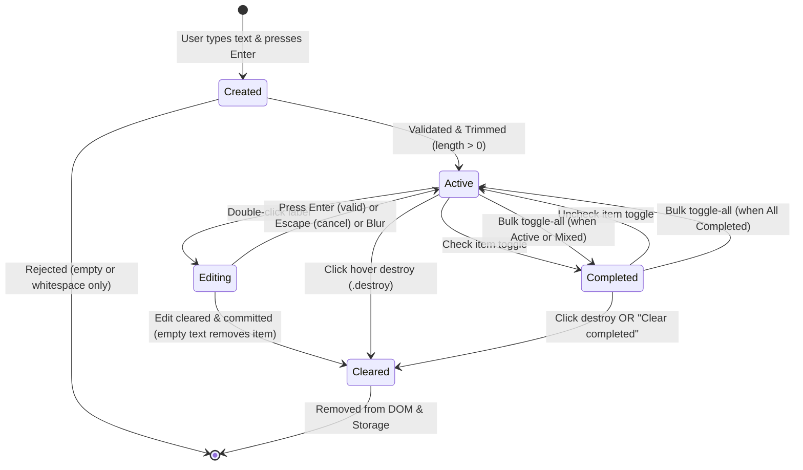

# Feature Contract Specification: TodoMVC State Lifecycle, Boundary Handling & Network Resilience

## Feature Metadata
- **Feature Name**: TodoMVC Task State Lifecycle, Boundary Inputs & Network Resilience
- **Target Tier**: Tier 2 (Advanced Assessment)
- **Author**: David Rivera (Senior SDET)
- **Date**: 2026-10-23
- **Target Application**: [TodoMVC Playwright Demo](https://demo.playwright.dev/todomvc)
- **Framework Standards**: [AGENTS.md](../../AGENTS.md) Strict Compliance
- **Specification Methodology**: Spec-Driven Development (SDD) & Model Context Protocol (MCP) Tool Integration

---

## 1. Feature Description & Scope

The **TodoMVC** application is a canonical Single Page Application (SPA) demonstrating task lifecycle orchestration, reactive DOM updates, local persistence (`localStorage`), view filtering, and bulk state management.

### Architectural & Automation Scope
1. **Spec-Driven Quality Contract**: Establish formal invariants for task state transitions (Created, Active, Editing, Completed, Cleared) before writing test orchestration.
2. **Strict Page Object Model (POM) Encapsulation**: In accordance with `AGENTS.md` Rule 1, spec files will never perform direct locator queries (`page.locator()`, `page.getByRole()`). All selectors are strictly encapsulated within `TodoPage`.
3. **Boundary Value & Data-Driven Rigor**: Standardize boundary handling (empty strings, whitespace trimming, multi-byte Unicode/emojis, strings > 250 characters, and bulk toggle actions) fed by a custom MCP test data generator (`src/mcp/todo-data-generator.ts`).
4. **Network Resilience & Zero-Timeout Synchronization**: Define explicit contracts for route interception using Playwright's `page.route()`, simulating artificial latency, offline boundaries, and state hydration without resorting to forbidden arbitrary sleeps (`page.waitForTimeout()`).

---

## 2. Preconditions & Test Environment Configuration

### 2.1 Environmental Preconditions
- **Base URL**: `https://demo.playwright.dev/todomvc`
- **Execution Target**: Chromium Desktop (Viewport: 1280x720, default headless mode).
- **Authentication State**: Public / Guest session (no Cognito or OAuth redirect required; clean browser context per worker).
- **Storage Isolation**: Every test execution starts with a completely sanitized storage state (`localStorage.clear()`) to guarantee test idempotency and prevent test bleed.

### 2.2 DOM Ready State Contract
Before any user workflow is orchestrated:
1. Navigation resolves with `domcontentloaded`.
2. The primary input `page.getByPlaceholder('What needs to be done?')` is auto-waited until visible, enabled, and editable.
3. The main list container `.todo-list` and footer controls are initially hidden until at least one task is created.

---

## 3. Behavioral Scenarios & State Lifecycle Model

### 3.1 Finite State Machine (FSM) Lifecycle
A task progresses through five discrete lifecycle states:



### 3.2 State Definitions
| State | Entry Trigger | Visual / DOM Markers | Active Count Impact | Persistence Key |
|-------|---------------|----------------------|---------------------|-----------------|
| **Created** | User types input and presses `Enter`. | Input value captured; transient state during parsing. | None (transient) | In-memory |
| **Active** | Valid non-empty text committed. | `li` element rendered; checkbox unchecked; label visible; `.todo-count` reflects task. | Increments (`+1`) | `localStorage: "todos-playwright"` |
| **Editing** | Double click (`dblclick`) on item label. | Class `.editing` applied to `li`; hidden `<label>` and `<button class="destroy">`; focused `<input class="edit">`. | Unchanged | In-memory during edit |
| **Completed** | Checkbox toggled to checked state. | Class `.completed` applied to `li`; checkbox checked; strikethrough styling; "Clear completed" button visible. | Decrements (`-1`) | `localStorage: "todos-playwright"` |
| **Cleared** | User clicks `.destroy` or clicks `Clear completed`. | Element completely detached from DOM (`expect(item).toHaveCount(0)`); removed from storage array. | Decrements if previously Active | Removed from `localStorage` |

### 3.3 State Transition Matrix & Verification Invariants

| Transition ID | Current State | Trigger Action | Expected Next State | Auto-Waiting Assertion Criteria (Rule 4) |
|---|---|---|---|---|
| **TR-01** | Initial (Empty) | Enter non-empty string in input and submit | `Active` | `await expect(todoItems).toHaveCount(1)`<br>`await expect(itemLabel).toHaveText(expectedText)`<br>`await expect(todoCount).toContainText('1 item left')` |
| **TR-02** | `Active` | Click item checkbox | `Completed` | `await expect(item).toHaveClass(/completed/)`<br>`await expect(checkbox).toBeChecked()`<br>`await expect(todoCount).toContainText('0 items left')`<br>`await expect(clearCompletedButton).toBeVisible()` |
| **TR-03** | `Completed` | Click item checkbox | `Active` | `await expect(item).not.toHaveClass(/completed/)`<br>`await expect(checkbox).not.toBeChecked()`<br>`await expect(todoCount).toContainText('1 item left')` |
| **TR-04** | `Active` | Double-click item label | `Editing` | `await expect(item).toHaveClass(/editing/)`<br>`await expect(editInput).toBeFocused()` |
| **TR-05** | `Editing` | Edit text and press `Enter` | `Active` | `await expect(item).not.toHaveClass(/editing/)`<br>`await expect(itemLabel).toHaveText(updatedText)` |
| **TR-06** | `Editing` | Press `Escape` | `Active` | `await expect(item).not.toHaveClass(/editing/)`<br>`await expect(itemLabel).toHaveText(originalText)` |
| **TR-07** | `Editing` | Clear all text and press `Enter` | `Cleared` | `await expect(todoItems).toHaveCount(0)` |
| **TR-08** | `Active` | Click `.destroy` button on item | `Cleared` | `await expect(todoItems).toHaveCount(0)`<br>`await expect(mainContainer).toBeHidden()` |
| **TR-09** | `Completed` | Click "Clear completed" button | `Cleared` | `await expect(clearCompletedButton).toBeHidden()`<br>`await expect(completedItems).toHaveCount(0)` |
| **TR-10** | `Active` / `Mixed` | Click `toggle-all` checkbox | `All Completed` | `await expect(todoItems.filter({ hasNotClass: 'completed' })).toHaveCount(0)`<br>`await expect(todoCount).toContainText('0 items left')` |
| **TR-11** | `All Completed` | Click `toggle-all` checkbox | `All Active` | `await expect(todoItems.filter({ hasClass: 'completed' })).toHaveCount(0)`<br>`await expect(todoCount).toContainText('${N} items left')` |

---

## 4. Boundary Conditions & Edge Case Specifications

Applying Equivalence Partitioning (EP) and Boundary Value Analysis (BVA):

### 4.1 Boundary Matrix
| Edge Case Category | Input Payload / Action | Expected System Behavior | Failure Mode Prevented |
|---|---|---|---|
| **Empty String** | `""` + Press `Enter` | Input remains empty; no task created; item count remains 0; list stays hidden. | Phantom/blank list items; DOM pollution. |
| **Whitespace Only** | `"   "`, `"\t"`, `"\n   "` + `Enter` | Input value is trimmed; because trimmed length is 0, submission is discarded; input reset. | Ghost items with invisible clickable surface. |
| **Leading & Trailing Spaces** | `"   Buy Organic Milk   "` | Item created with trimmed text: `"Buy Organic Milk"`. | Formatting inconsistency, search/filter index mismatch. |
| **Unicode & Emojis** | `"🚀 Release v2.0 - 自动化测试 - مرحبا - Ñandú - 100% ✨"` | Item created and displayed with exact glyph fidelity; persistent in storage; full accessibility support. | UTF-8 encoding corruption, database/storage serialization crash. |
| **Extreme Length (> 250 Chars)** | `260+ alphanumeric string` (e.g., `Lorem ipsum...`) | Item created; CSS wraps long strings (`word-break: break-all` / `text-overflow`); actionability checks on buttons remain unobstructed. | Viewport overflow, UI displacement pushing buttons out of view, locator occlusion. |
| **Bulk Action (toggle-all)** | 10 mixed items (5 active, 5 completed) -> click toggle-all | All 10 items transition atomically to `Completed`; active count displays `0 items left`; `Clear completed` button active. | Race condition in loop updates; desynchronized counter. |
| **Filter Switching Stability** | Switch rapidly between `All`, `Active`, `Completed` with 20 items | Visual items filtered dynamically matching exact state count without reloading or page flickering. | Stale element references, race condition between URL hash change (`#/active`) and DOM re-render. |

---

## 5. Network Interception Contract (`page.route()`)

While TodoMVC primarily operates client-side with `localStorage`, enterprise SDET standards require establishing network contract boundaries for:
1. Simulated backend synchronization / telemetry pings.
2. Artificial latency simulation to validate Playwright auto-waiting guarantees.
3. Offline recovery and error resilience.

### Scenario A: Artificial Latency & Non-Blocking Auto-Waiting Contract
- **Objective**: Prove that tests remain 100% deterministic under asynchronous delay without arbitrary sleeps (`page.waitForTimeout()`).
- **Interception Rule**:
  ```typescript
  // Mock artificial server latency for background sync or asset hydration
  await page.route('**/sync-api/**', async (route) => {
    // Inject deterministic 1200ms delay simulating high-latency edge or mobile connection
    await new Promise((resolve) => setTimeout(resolve, 1200));
    await route.fulfill({
      status: 200,
      contentType: 'application/json',
      body: JSON.stringify({ synced: true, timestamp: Date.now() }),
    });
  });
  ```
- **Verification Guarantee**: Specs rely strictly on Playwright web-first assertions (`await expect(locator).toBeVisible()`) and event waits (`await page.waitForResponse(resp => resp.status() === 200)`), never timing out or requiring manual pauses.

### Scenario B: State Synchronization & Offline Degradation Contract
- **Objective**: Verify that when external telemetry or cloud sync fails, the client-side app degrades gracefully without breaking active user workflows.
- **Interception Rule**:
  ```typescript
  // Intercept and simulate HTTP 500 or offline network fault
  await page.route('**/telemetry/**', (route) => route.abort('failed'));
  await page.route('**/api/backup/**', (route) =>
    route.fulfill({
      status: 503,
      contentType: 'application/json',
      body: JSON.stringify({ error: 'Service Unavailable' }),
    })
  );
  ```
- **Verification Guarantee**: No unhandled promise rejections occur in browser console; local tasks continue to persist in `localStorage`; UI remains reactive.

### Scenario C: Pre-seeded Hydration Contract
- **Objective**: Intercept initial page bootstrap or inject simulated pre-existing dataset into `localStorage` before page load to test bulk rendering speed and immediate state stability.
- **Verification Guarantee**: The Page Object provides a clean `seedTodos(items: TodoItem[])` contract that populates state and verifies that DOM renders all items with zero hydration mismatches.

---

## 6. MCP Inspection Plan & Locator Strategy

Adhering strictly to **`AGENTS.md` Rule 3 (Accessibility-First Locator Strategy)**:

| Component | Semantic Role / Accessibility Name | Primary Locator Strategy | Forbidden Anti-Patterns |
|---|---|---|---|
| **New Todo Input** | `role: 'textbox'`, Placeholder: `'What needs to be done?'` | `page.getByPlaceholder('What needs to be done?')` | `page.locator('input.new-todo')` |
| **Todo List Container** | `role: 'list'` | `page.getByRole('list')` | `page.locator('ul.todo-list')` |
| **Todo Item** | `role: 'listitem'` | `page.getByRole('listitem')` | `page.locator('li')` |
| **Item Checkbox** | `role: 'checkbox'` | `todoItem.getByRole('checkbox')` | `page.locator('.toggle')` |
| **Item Label** | Text container | `todoItem.getByText(expectedText, { exact: true })` | `page.locator('label')` |
| **Item Edit Input** | `role: 'textbox'` | `todoItem.getByRole('textbox')` | `page.locator('.edit')` |
| **Item Destroy Button** | `role: 'button'`, Name: `'Delete'` | `todoItem.getByRole('button', { name: 'Delete' })` | `page.locator('.destroy')` |
| **Toggle All Checkbox**| `role: 'checkbox'`, Name: `'Mark all as complete'` | `page.getByLabel('Mark all as complete')` | `page.locator('#toggle-all')` |
| **Clear Completed** | `role: 'button'`, Name: `'Clear completed'` | `page.getByRole('button', { name: 'Clear completed' })` | `page.locator('.clear-completed')` |
| **Filter Link - All** | `role: 'link'`, Name: `'All'` | `page.getByRole('link', { name: 'All' })` | `page.locator('a[href="#/"]')` |
| **Filter Link - Active**| `role: 'link'`, Name: `'Active'` | `page.getByRole('link', { name: 'Active' })` | `page.locator('a[href="#/active"]')` |
| **Filter Link - Completed**| `role: 'link'`, Name: `'Completed'` | `page.getByRole('link', { name: 'Completed' })` | `page.locator('a[href="#/completed"]')` |
| **Item Count Tally** | Text container | `page.locator('.todo-count')` (encapsulated in POM) | Direct spec assertion |

---

## 7. Data-Driven Testing & MCP Custom Tool Contract

To feed high-coverage parameterized regression suites, the test suite integrates the custom MCP tool `generate_todo_dataset`:
- **Tool Schema**: Defined in `src/mcp/todo-data-generator.json`.
- **Pure Logic Implementation**: Defined in `src/mcp/todo-data-generator.ts`.
- **Parametric Test Integration**:
  ```typescript
  import { test, expect } from '@fixtures';
  import { generateTodoDataset } from '../../src/mcp/todo-data-generator';

  const testDataset = generateTodoDataset({
    count: 5,
    includeSpecialChars: true,
    state: 'mixed',
  });

  for (const item of testDataset) {
    test(`Data-driven test: ${item.category} - ${item.title.slice(0, 30)}`, async ({ todoPage }) => {
      await todoPage.addTodo(item.title);
      if (item.completed) {
        await todoPage.completeTodoByText(item.title);
      }
      // Assertions delegated through Page Object
    });
  }
  ```

---

## 8. Quality Gates & Non-Functional Criteria

Before merging or promoting any code in Tier 2:
- [x] **Strict POM Encapsulation**: 0 locator calls inside `tests/**/*.spec.ts`.
- [x] **Zero Arbitrary Timeouts**: 0 instances of `page.waitForTimeout()` anywhere in the repository.
- [x] **Web-First Assertions**: All assertions use `await expect(...)` with auto-waiting.
- [x] **TypeScript Compliance**: `npm run typecheck` exits with code 0 and zero warnings.
- [x] **Deterministic Headless Execution**: Suite executes reliably without flaky race conditions.
